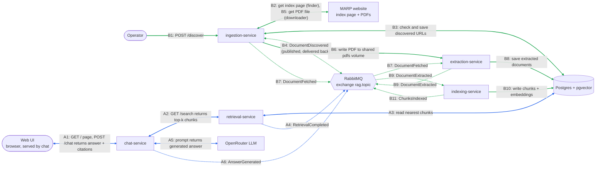

# RAG-Chatbot

A retrieval-augmented chatbot that answers questions using your own documents.

## Team

| Name              | GitHub            |
|-------------------|-------------------|
| Amr Khalil Taoumi | @AmrTaoumi        |
| Layla Alwahabi    | @layla-alw        |
| Walid Alwahabi    | @Walid-Alwahabi   |


## Architecture

Event-driven microservices. Services talk by REST (synchronous) and by RabbitMQ events (asynchronous, exchange `rag.topic`). PDFs move between services over a shared Docker volume, never through the broker. Full diagram, step-by-step flows and event schemas: [`docs/architecture/architecture-event-flow.md`](docs/architecture/architecture-event-flow.md), [`docs/events/event-catalogue.md`](docs/events/event-catalogue.md), [`docs/architecture/contracts.md`](docs/architecture/contracts.md).

Two flows:

- **Flow B, load documents:** scrape MARP index page, download PDFs, extract text, chunk, embed, store in pgvector.
- **Flow A, answer a question:** embed question, vector search, LLM prompt, answer with citations.



**Legend**

- **Solid double arrow:** synchronous call (REST or SQL). The caller is the left-hand node and waits for the reply; the label says what is asked and what comes back.
- **Solid one-way arrow:** a write with no meaningful reply, or a file on the shared `pdfs` volume (not a network call).
- **Dotted arrow:** asynchronous event through RabbitMQ (exchange `rag.topic`). The publisher does not wait. Publishing and delivering an event share one step number.
- **Colours:** blue = flow A, green = flow B.

### Flow B — loading documents

1. **B1** An operator calls `POST /discover` on ingestion.
2. **B2** Ingestion downloads the MARP index page and collects every PDF link on it. This is the "discover" step; links are not hardcoded, so new or renamed PDFs are found automatically.
3. **B3** Ingestion checks `discovered_documents` and keeps only new URLs, so each PDF is processed once.
4. **B4** For each new URL, ingestion publishes `DocumentDiscovered`. RabbitMQ delivers it back to ingestion's downloader (queue `ingestion.fetch`). Splitting finding from downloading means `POST /discover` returns quickly, and an interrupted download is not lost because the event stays in the queue.
5. **B5** The downloader fetches the PDF from MARP, waiting 5 seconds between requests (`robots.txt` crawl delay).
6. **B6** Ingestion writes the PDF to the shared `pdfs` volume as `/data/pdfs/{doc_id}.pdf`.
7. **B7** Ingestion publishes `DocumentFetched` with the file path. RabbitMQ delivers it to extraction (queue `extraction.documents`). The PDF itself never travels through RabbitMQ.
8. **B8** Extraction reads the PDF, extracts the text page by page, and saves it in `documents`.
9. **B9** Extraction publishes `DocumentExtracted` with the page texts. RabbitMQ delivers it to indexing (queue `indexing.documents`).
10. **B10** Indexing splits each page into ~200-token chunks with 40-token overlap, embeds them with `BAAI/bge-small-en-v1.5` (384 dimensions, normalised), and writes them to `chunks`.
11. **B11** Indexing publishes `ChunksIndexed`.

### Flow A — answering a question

1. **A1** The browser loads the web UI from chat (`GET /`) and sends the user's question (`POST /chat`).
2. **A2** Chat calls retrieval `GET /search` with the question and an `X-Correlation-ID` header.
3. **A3** Retrieval embeds the question with the same model as indexing and returns the top-k nearest chunks by cosine similarity (chat asks for `k=8`), each with title, page and URL.
4. **A4** Retrieval publishes `RetrievalCompleted`.
5. **A5** If the best chunk scores below `SCORE_THRESHOLD` (default `0.6`), chat skips the LLM and returns the fallback `not certain / no source found` with no citations. Otherwise it builds a numbered prompt from the question and the chunks and sends it to the OpenRouter LLM. An answer that cites no valid source also becomes the fallback.
6. **A6** Chat publishes `AnswerGenerated`, then returns the answer and citations (title, page, link) to the browser over the A1 connection.

### Services

| Service    | Port | Role                                                        | Status in `docker compose` |
|------------|------|-------------------------------------------------------------|----------------------------|
| ingestion  | 8001 | Discover PDF links on MARP page, download PDFs              | running                    |
| extraction | 8005 | Extract per-page text from PDFs                             | running                    |
| indexing   | 8002 | Chunk (~200 tokens, 40 overlap), embed, store               | running                    |
| retrieval  | 8003 | Vector search over pgvector                                 | running                    |
| chat       | 8004 | Prompt + LLM, citations, serves web UI                      | running                    |
| postgres   | 5432 | Postgres 16 + pgvector                                      | running                    |
| rabbitmq   | 5672 / 15672 | AMQP broker / management UI                         | running                    |

Each table has one owning service: `discovered_documents` (ingestion), `documents` (extraction), `chunks` (indexing, read-only for retrieval). `ChunksIndexed`, `RetrievalCompleted` and `AnswerGenerated` have no consumer yet; RabbitMQ drops them until one binds a queue.

Per-service details: [`docs/services/`](docs/services/).

Feature designs for Sprint 2: Tier 1 auth and sessions ([`docs/features/design-tier1-auth-sessions.md`](docs/features/design-tier1-auth-sessions.md)), Tier 2 rate limiting and caching ([`docs/features/design-tier2-rate-limit-cache.md`](docs/features/design-tier2-rate-limit-cache.md)).

Scrum artefacts (product goal, backlog, sprint log, retrospective): [`docs/scrum/scrum-artefacts.md`](docs/scrum/scrum-artefacts.md).

## Technology Stack

| Area            | Choice                                                         |
|-----------------|----------------------------------------------------------------|
| Language        | Python 3.12                                                    |
| API framework   | FastAPI + Uvicorn                                              |
| Messaging       | RabbitMQ 3.13 (topic exchange `rag.topic`), `pika`             |
| Database        | PostgreSQL 16 with `pgvector` (HNSW cosine index, 384 dims)    |
| DB driver       | `psycopg` 3                                                    |
| PDF extraction  | `pdfplumber`                                                   |
| Scraping / HTTP | `httpx`, `beautifulsoup4`                                      |
| Chunking        | `tiktoken`                                                     |
| Embeddings      | `BAAI/bge-small-en-v1.5` via `sentence-transformers` (local, CPU, shared by indexing and retrieval) |
| LLM             | OpenRouter (model set by `OPENROUTER_MODEL`, default `nvidia/nemotron-3.5-super-vl:free`) |
| Packaging       | Docker, Docker Compose                                         |
| Testing / CI    | pytest, GitHub Actions (tests + `docker compose build`)        |

## Setup and Run

### Prerequisites

- Docker with Compose v2 (Docker Desktop on Windows)
- Git
- Internet access and about 6 GB free disk (the first build downloads PyTorch and the embedding model)
- Free ports: 5432, 5672, 15672, 8001, 8002, 8003, 8004, 8005
- (Python 3.12 only if you run tests outside Docker)

On Windows, run the commands below in Git Bash or WSL.

### Installation

```bash
git clone https://github.com/AmrTaoumi/RAG-Chatbot-.git
cd RAG-Chatbot-
cp .env.example .env
```

Defaults in `.env.example` work for the pipeline. For chat, set `OPENROUTER_API_KEY` in `.env` (free key at https://openrouter.ai/keys). `OPENROUTER_MODEL` defaults to `nvidia/nemotron-3.5-super-vl:free`, and `SCORE_THRESHOLD` (minimum retrieval score before the LLM is called) to `0.6`.

### Running

```bash
docker compose up --build -d
```

The first build takes several minutes. After start-up, give indexing and retrieval up to a minute to load the embedding model. Then check:

```bash
curl localhost:8001/health      # ingestion  -> {"status":"ok"}
curl localhost:8002/health      # indexing   -> {"status":"ok"}
curl localhost:8003/health      # retrieval  -> {"status":"ok"}
curl localhost:8004/health      # chat       -> {"status":"ok"}
curl localhost:8005/health      # extraction -> {"status":"ok"}
```

Optional: watch queues and events in the RabbitMQ UI at http://localhost:15672 (login from `.env`, default `guest` / `guest`).

Load documents:

```bash
curl -X POST localhost:8001/discover
```

Ingestion finds PDF links on the MARP page and downloads them one every 5 seconds (site `robots.txt` crawl delay). Extraction, indexing and the rest of the pipeline pick each file up automatically. Watch progress with `docker compose logs -f ingestion extraction indexing`.

Ask a question in the web UI at http://localhost:8004, or with curl:

```bash
curl -X POST localhost:8004/chat -H 'Content-Type: application/json' \
  -d '{"question": "what is the late submission penalty?"}'
```

Stop: `docker compose down` (add `-v` to also wipe the database and downloaded PDFs).

### Tests

```bash
cd services/ingestion   # or extraction, indexing, retrieval, chat
pip install -r requirements.txt
python -m pytest
```

## Branching & Workflow
- `main`: stable, release-ready code
- `develop`: integration branch, **all PRs target this**
- Feature branches: `feature/<task-id>-short-name`, e.g. `feature/S1-02-login`

## Contributing
1. Pick a task from the project board
2. Branch off `develop`
3. Open a PR into `develop` and request a review