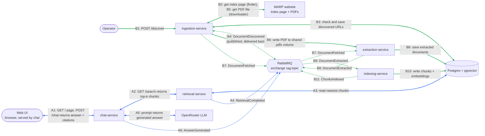

# Architecture

This diagram shows every service, how they communicate, and the order of the two main flows:

- **Flow B — loading documents (green):** runs first. It fills the database with searchable chunks from the MARP PDFs.
- **Flow A — answering a question (blue):** runs for every user question. It reads the chunks that flow B stored.

## Legend

- **Solid double arrow:** synchronous call (REST or SQL). The caller is the left-hand node and waits for the reply; the label says what is asked and what comes back.
- **Solid one-way arrow:** a write with no meaningful reply, or a file on the shared `pdfs` volume (not a network call).
- **Dotted arrow:** asynchronous event through RabbitMQ (exchange `rag.topic`). The publisher does not wait. Publishing and delivering an event share one step number.
- **Colours:** blue = flow A, green = flow B.

## Flow B — loading documents

1. **B1** An operator calls `POST /discover` on ingestion.
2. **B2** Ingestion downloads the MARP index page and collects every PDF link on it. This is the "discover" step; links are not hardcoded, so new or renamed PDFs are found automatically.
3. **B3** Ingestion checks `discovered_documents` and keeps only new URLs, so each PDF is processed once.
4. **B4** For each new URL, ingestion publishes `DocumentDiscovered`. RabbitMQ delivers it back to ingestion's downloader (queue `ingestion.fetch`). Splitting finding from downloading means `POST /discover` returns quickly, and an interrupted download is not lost because the event stays in the queue.
5. **B5** The downloader fetches the PDF from MARP, waiting 5 seconds between requests (`robots.txt` crawl delay).
6. **B6** Ingestion writes the PDF to the shared `pdfs` volume as `/data/pdfs/{doc_id}.pdf`.
7. **B7** Ingestion publishes `DocumentFetched` with the file path. RabbitMQ delivers it to extraction (queue `extraction.documents`). The PDF itself never travels through RabbitMQ.
8. **B8** Extraction reads the PDF, extracts the text page by page, and saves it in `documents`.
9. **B9** Extraction publishes `DocumentExtracted` with the page texts. RabbitMQ delivers it to indexing (queue `indexing.documents`).
10. **B10** Indexing splits each page into ~200-token chunks with 40-token overlap, embeds them with `BAAI/bge-small-en-v1.5` (384 dimensions, normalised), and writes them to `chunks`.
11. **B11** Indexing publishes `ChunksIndexed`.

## Flow A — answering a question

1. **A1** The browser loads the web UI from chat (`GET /`) and sends the user's question (`POST /chat`).
2. **A2** Chat calls retrieval `GET /search` with the question and an `X-Correlation-ID` header.
3. **A3** Retrieval embeds the question with the same model as indexing and returns the top-k nearest chunks by cosine similarity (chat asks for `k=8`), each with title, page and URL.
4. **A4** Retrieval publishes `RetrievalCompleted`.
5. **A5** If the best chunk scores below `SCORE_THRESHOLD` (default `0.6`), chat skips the LLM and returns the fallback `not certain / no source found` with no citations. Otherwise it builds a numbered prompt from the question and the chunks and sends it to the OpenRouter LLM. An answer that cites no valid source also becomes the fallback.
6. **A6** Chat publishes `AnswerGenerated`, then returns the answer and citations (title, page, link) to the browser over the A1 connection.

## Notes

- `ChunksIndexed`, `RetrievalCompleted` and `AnswerGenerated` have no consumer yet. They are published with `mandatory=False`, so RabbitMQ drops them until a consumer binds a queue. A consumer (for example logging or a monitoring dashboard) can be added later without changing the publishers.
- Every event uses the envelope in `docs/events/event-catalogue.md`. One `correlationId` follows each document through flow B and each question through flow A.
- Each table has one owning service: `discovered_documents` (ingestion), `documents` (extraction), `chunks` (indexing, read-only for retrieval). Chat has no database access yet.
- A semantic cache in chat is planned for Sprint 2 (Tier 2, see [`design-tier2-rate-limit-cache.pdf`](design-tier2-rate-limit-cache.pdf)). It is not part of this diagram.
- The web UI is a static page served by chat, not a separate service.
- There are five core services: ingestion, extraction, indexing, retrieval and chat.

