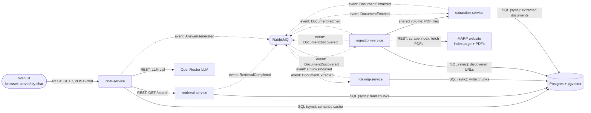

# Architecture

**Status:** Draft. Replaces `docs/material/Lancaster MARP Retrieval Pipeline-2026-10-19-120156.pdf` as the source of truth once approved. Covers both the service overview (Week 2) and the event flow (Week 3).

## Legend

- Solid arrow: synchronous call (REST or SQL). The caller waits for the reply.
- Solid arrow labelled "shared volume": files on a shared Docker volume, not a network call.
- Dotted arrow: asynchronous event through RabbitMQ (exchange `rag.topic`). The publisher does not wait.

## Notes

- `ChunksIndexed`, `RetrievalCompleted` and `AnswerGenerated` have no consumer yet. RabbitMQ drops them until a consumer binds a queue, so one can be added later without changing the publishers.
- `DocumentDiscovered` is published and consumed by ingestion itself (queue `ingestion.fetch`).
- Chat caches answers in Postgres (`semantic_cache`) for `CACHE_TTL_SECONDS` (default 24 hours), so it does not consume `ChunksIndexed`.
- Ingestion keeps discovered URLs in Postgres (`discovered_documents`). Extraction keeps extracted documents (`documents`).
- Ingestion downloads each PDF to the shared `pdfs` volume and publishes `DocumentFetched` with the file path. Extraction reads it from there, so no PDF travels through RabbitMQ.
- The web UI is a static page served by chat (`GET /`), not a separate service.
- Events with a consumer use `mandatory=True`. The three events with no consumer are published with `mandatory=False`, so they are dropped quietly.
- There are five core services: ingestion, extraction, indexing, retrieval and chat.
