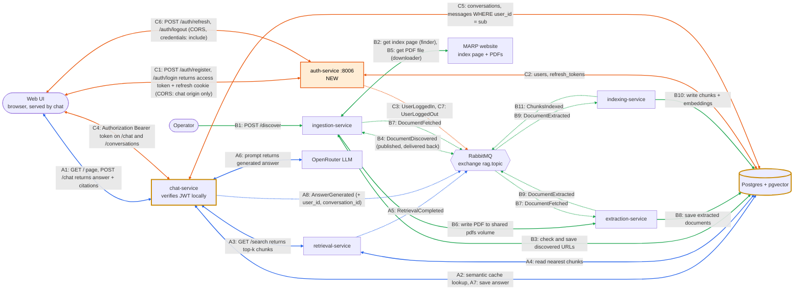

# Tier 1 design

## A. What

- Feature: User Authentication & Session Management

- Why: currently, the /chat endpoint does not identify individual users. This means conversations cannot be saved separately or protected based on user identity. In addition authentication is necessary before introducing user-specific features.

- User stories:
a. As a student, I want to register and log in so my chats are saved. 
AC: 
-valid email and a password of 8+ characters gives 201. 
-A duplicate email gives 409. Correct credentials return an access token and set a refresh-token cookie. 
-Wrong credentials give 401 with a generic message.

b. As a student, I want to log out so nobody else on a shared PC sees my chats. 
AC: 
-Logging out revokes the refresh token.
-The revoked refresh token can no longer be used to get a new access token.
-The refresh cookie is cleared.
-The access token already issued stays valid until it expires (at most 15 minutes).

c. As a student, I want my conversations to remain private so that I can only access my own chat history. 
AC: 
-GET /conversations returns only conversations belonging to the logged-in user.
-Users cannot access conversations belonging to other accounts.
-Requesting another user's conversation ID returns HTTP 404 rather than HTTP 403.

## B. Where it fits

- New: auth service on port 8006. It issues and signs tokens and owns users and refresh tokens. It enables CORS for the chat origin, because the UI (served by chat on 8004) calls it from the browser.
- Changed: chat (8004) verifies the JWT itself, with no call to auth, and stores conversations per user.
- Unchanged: ingestion, indexing, retrieval, extraction. 
- Diagram:


Legend:
orange = new (auth service, flow C), yellow border = changed (chat, DB). Blue (A) and green (B) are unchanged from `docs/architecture-event-flow.md`. There is no chat → auth arrow: chat verifies the JWT itself with auth's public key. The UI → auth arrows (C1, C6) are cross-origin (8004 → 8006), so auth allows the chat origin with CORS.

## C. Interfaces

Auth endpoints:

| Method | Path | Body | Response |
|---|---|---|---|
| POST | /auth/register | {email, password} | 201 {user_id, email}; 409 |
| POST | /auth/login | {email, password} | 200 {access_token, token_type: "bearer", expires_in: 900} + refresh cookie; 401 |
| POST | /auth/refresh | refresh cookie | 200 new access_token, refresh token rotated; 401 |
| POST | /auth/logout | refresh cookie | 204, refresh token revoked, cookie cleared |
| GET | /auth/me | Authorization: Bearer | 200 {user_id, email}; 401 |

Chat changes (all need Authorization: Bearer <token>, and return 401 without it):
- POST /chat takes {question, conversation_id?} and returns the existing response plus conversation_id.
- GET /conversations lists the current user's conversations.
- GET /conversations/{id}/messages returns one conversation's messages.
- DELETE /conversations/{id} deletes one conversation.

JWT payload (draft):
{"sub": "u123", "email": "a@lancaster.ac.uk", "iat": 1761900000, "exp": 1761900900, "jti": "t789"} # jti is a unique identifier for this token

Events:
```json
{
  "eventType": "UserLoggedIn",
  "eventId": "3f2b8c1e-5d0a-4c1e-9a7b-1e2d3c4b5a70",
  "timestamp": "2026-11-01T10:00:00Z",
  "correlationId": "c1d2e3f4-1a2b-4c3d-8e9f-0a1b2c3d4e5f",
  "payload": {
    "user_id": "u123"
  }
}
```

```json
{
  "eventType": "UserLoggedOut",
  "eventId": "3f2b8c1e-5d0a-4c1e-9a7b-1e2d3c4b5a71",
  "timestamp": "2026-11-01T11:00:00Z",
  "correlationId": "d4e5f6a7-2b3c-4d5e-9f0a-1b2c3d4e5f6a",
  "payload": {
    "user_id": "u123"
  }
}
```

Changed event: `AnswerGenerated` adds `user_id` and `conversation_id` to its payload. No tokens or passwords in events.

Data model. Each table has one owning service, which creates it on startup (`CREATE TABLE IF NOT EXISTS`) and is the only one that writes to it. IDs are UUIDs stored as `TEXT`, like `doc_id`.

Owned by auth:
- users(id, email UNIQUE, password_hash, created_at)
- refresh_tokens(id, user_id FK to users, token_hash, expires_at, revoked_at, created_at)

Owned by chat:
- conversations(id, user_id, title, created_at)
- messages(id, conversation_id FK to conversations, role, content, citations JSONB, created_at)

`conversations.user_id` is a plain `TEXT` column holding the JWT `sub`. It has no foreign key to `users`, because that table belongs to another service. Deleting a user is out of scope for Tier 1.


## D. How

- Passwords: hash with Argon2 or bcrypt. Never store or log plaintext.
- Two tokens:
  - Access token: a JWT that lasts 15 minutes. The UI keeps it in memory and sends it as Authorization: Bearer.
  - Refresh token: a random opaque string that lasts 7 days. It lives in an HttpOnly, SameSite=Strict cookie scoped to /auth, and the DB stores only its hash. It's rotated on every refresh.
- Signing: RS256 using PyJWT. Only auth holds the private key; chat gets the public key from config. If chat is compromised, it can't mint tokens.
- Verification in chat: a FastAPI dependency checks the signature and exp, pins algorithms=["RS256"] (which rejects alg: none), then reads user_id from sub.
- Isolation: every query uses WHERE user_id = :sub. Never take user_id from the request body.
- Semantic cache: the cache is shared between users, so it holds only question, answer and citations, never user data. On a cache hit, chat still saves the answer as a message in the asking user's conversation, and `AnswerGenerated` still carries that user's `user_id` and `conversation_id`.
- Logout: revoke the refresh token in the DB. The access token stays valid until it expires, at most 15 minutes. That's an accepted trade-off for an internal chatbot. An optional fix is a jti denylist.
- CORS: the UI is served by chat (8004) but calls auth (8006). That is a different origin, so auth enables CORS.
  - Auth allows only the chat origin, taken from a `CORS_ALLOWED_ORIGINS` setting (no `*`), with `allow_credentials=True` and the `Authorization` and `Content-Type` headers allowed. FastAPI's `CORSMiddleware` also answers the preflight `OPTIONS` requests.
  - The UI calls auth with `fetch(url, {credentials: "include"})`, otherwise the browser drops the refresh cookie.
  - The cookie still works across the two ports: `SameSite` compares sites, not ports, and both are on the same host.
  - Chat needs no CORS, because the browser calls it from its own origin.

- Alternative considered: server-side sessions.
  - Pro: instant, true logout.
  - Pro: simpler token handling.
  - Con: every chat request needs a DB lookup or a call to auth. That couples chat to auth at runtime and adds latency, so auth becomes a single point of failure.
  - Decision: JWT. It's stateless and verified locally, which fits the microservice design. Short expiry plus revocable refresh tokens covers most of the logout weakness.

- Alternative considered for CORS: proxy `/auth/*` through chat.
  - Pro: one origin, so no CORS and no `credentials` flag.
  - Con: adds a chat → auth runtime path, so an auth outage breaks logins through chat, and chat must forward `Set-Cookie`. It also contradicts the diagram, where chat never calls auth.
  - Decision: CORS on auth. It keeps chat decoupled (no chat → auth call) and costs a few lines of config.

## E. Plan (Sprint 2 issues)

| # | Issue | Est. | Owner |
|---|---|---|---|
| 1 | Scaffold auth service, add to docker-compose and .env.example, CORS config (`CORS_ALLOWED_ORIGINS`) | 0.5d | Amr |
| 2 | Table creation on startup: users and refresh_tokens in auth, conversations and messages in chat (each owner creates its own) | 1d | Walid |
| 3 | Register and login with hashing and JWT issuing | 1.5d | Layla |
| 4 | Refresh token rotation and logout revocation | 1.5d | Amr |
| 5 | Chat: JWT verification, scope /chat per user | 1d | Walid |
| 6 | Chat: conversation list, get and delete endpoints | 1d | Layla |
| 7 | Publish UserLoggedIn / UserLoggedOut | 0.5d | Amr |
| 8 | Web UI: login form, token handling (calls auth with `credentials: "include"`), history view | 2d | Walid |
| 9 | Tests (section F), update contracts.md and architecture diagram | 1.5d | Layla |

## F. Verification

- Unit: password hashing; JWT encode/decode; expired, tampered, wrong-key and `alg: none` tokens rejected.
- Integration (pytest + TestClient + test Postgres): register → login → /auth/me 200; wrong password 401; old refresh token reused 401; refresh after logout 401.
- Isolation: user A's conversation gives 404 to user B on GET and DELETE and is not in B's list.
- Semantic cache: user A asks a question and it is cached. User B asks the same question and gets a cache hit. The answer is saved in B's conversation and not A's, and `AnswerGenerated` carries B's `user_id` and `conversation_id`.
- Security: no plaintext passwords or refresh tokens in the DB, cookie flags set, no tokens in logs.
- CORS: a request to auth with `Origin` set to the chat origin gets `Access-Control-Allow-Origin` for that origin and `Access-Control-Allow-Credentials: true`. An unlisted origin gets no CORS headers. The preflight `OPTIONS` request succeeds. Manual check in the browser: login from the UI on 8004 sets the refresh cookie, and `/auth/refresh` works afterwards.
- Done when all acceptance criteria pass in CI.

## G. Open decisions

To settle during the Sprint 2 issue that touches each one:

- Key setup (issues 1, 5): mounted key files or env vars for the RS256 pair. The private key is never committed.
- Brute-force protection (issue 3): rate limit per email and IP, or out of scope for Tier 1. Also whether emails are lowercased before the uniqueness check.
- Refresh-token reuse (issue 4): whether a detected reuse revokes all of that user's refresh tokens.
- Libraries (issues 1, 3): `argon2-cffi`, `PyJWT[crypto]` and `email-validator`, with pinned versions.