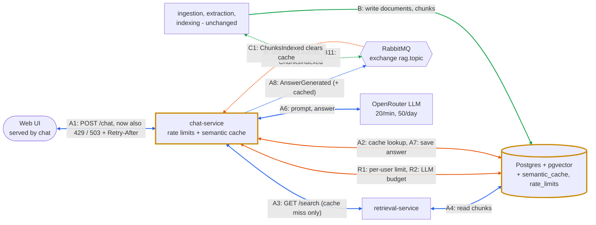

# Tier 2 design: Rate Limiting & Intelligent Caching

## A. What

**Feature:** per-user and global request limits, plus a semantic cache for similar questions.

**Why:** All users share one OpenRouter key, and `:free` models allow 20 requests per minute and 50 per day, counting retries. Chat's client retries a failed call up to 5 times, so one question can use 5 of those 20. Once the cap is hit, every `/chat` returns 502 until it resets, possibly mid-demo. Per-user limits stop one user from using up the quota, and the cache answers repeated questions in milliseconds without calling the LLM.

**User stories**

1. As a student, I want common questions answered quickly so I don't wait for the LLM every time.
   - A question with similarity ≥ 0.92 to an unexpired cached question is answered from the cache in under 500 ms, without calling retrieval or the LLM.
   - Fallback answers are never cached. Entries expire after 24 hours or when `ChunksIndexed` is received.
2. As the team running the demo, I want chat to stay under OpenRouter's limits so the demo never fails with 502.
   - Chat makes at most 15 LLM requests per minute and 45 per day, counting every retry.
   - When this budget is used up, cache hits still get 200 and cache misses get 503 with `Retry-After`.
3. As a student, I want the chatbot to stay available when another user sends many questions.
   - A user (JWT `sub`, or IP if not logged in) sending more than 5 requests per minute gets 429 with `Retry-After`.
   - Other users are not affected and still get 200.

## B. Where it fits

- **New:** no new service. Both parts live in chat, the only service that calls the LLM.
- **Changed:** chat (8004) gets a database connection, embeds questions with `BAAI/bge-small-en-v1.5` (same model and query prefix as retrieval), checks both limits and consumes `ChunksIndexed`. The DB gets two tables (section C).
- **Unchanged:** ingestion, extraction, indexing, retrieval.



Orange = new (rate limits R, cache A2/A7, cache invalidation C). Yellow border = changed (chat, DB). Blue (A) and green (B) are the flows from `docs/architecture-event-flow.md`, renumbered to include the new cache steps (A2, A7), with the pipeline services collapsed into one box. On a cache hit, chat skips A3–A6.

## C. Interfaces

**Chat changes.** No new endpoints. `POST /chat` returns `cached: true|false` with every answer, and gains two errors:

| Status | When | Body |
|---|---|---|
| 429 | User sent more than 5 requests this minute | `{"detail": "rate limit exceeded"}` + `Retry-After` |
| 503 | LLM budget used up and question not cached | `{"detail": "LLM budget exhausted"}` + `Retry-After` |

`Retry-After` is the number of seconds until the current window resets.

**Events (draft).** None new. `AnswerGenerated` adds `cached` to its payload, so the cache hit rate can be measured from the events. Example of a cache hit (`user_id` and `conversation_id` come from Tier 1):

```json
{
  "eventType": "AnswerGenerated",
  "eventId": "3f2b8c1e-5d0a-4c1e-9a7b-1e2d3c4b5a71",
  "timestamp": "2026-11-12T10:00:00Z",
  "correlationId": "d4e5f6a7-2b3c-4d5e-9f0a-1b2c3d4e5f60",
  "payload": {
    "question": "what is the late submission penalty?",
    "answer": "A 5-mark deduction per day up to a maximum of 5 days...",
    "citations": [
      {
        "title": "Academic Integrity Regulations",
        "url": "https://www.lancaster.ac.uk/.../Academic-Integrity-Regs.pdf",
        "page": 3
      }
    ],
    "user_id": "u123",
    "conversation_id": "c456",
    "cached": true
  }
}
```

Chat binds queue `chat.chunks-indexed` to `chunks.indexed`, making it the first consumer of `ChunksIndexed`. The event catalogue changes `ChunksIndexed` to `mandatory=True` with publisher confirms, like the other consumed events.

**Data model.** Both tables are owned by chat and created on startup.
- `semantic_cache(id, question, embedding vector(384), answer, citations JSONB, created_at, expires_at)`. `expires_at` is `created_at` + 24 hours; expired rows are ignored.
- `rate_limits(key, window_start, count)`, where `key` is `user:<sub>`, `ip:<address>`, `llm:minute` or `llm:day`. Rows older than a day are deleted, so IP addresses are not kept.

## D. How

- **Order in `/chat`:** per-user limit → embed question → cache lookup → retrieval and score threshold → global budget → LLM → save to cache. The cache comes before the budget, so cached questions still work once the budget is used up.
- **Retries:** chat checks and counts the global budget before every LLM attempt, including retries, because OpenRouter counts each one. If the budget runs out mid-retry, chat stops and returns 503.
- **Counting:** fixed one-minute and one-day windows. Each count is one atomic upsert, so two concurrent requests cannot both slip under the limit.
- **Similarity:** pgvector cosine distance on question embeddings, as in retrieval. 0.92 will be tuned on paraphrases (should hit) against near-misses such as "miss classes" vs "miss 5 classes" (should not).
- **Invalidation:** every `ChunksIndexed` clears the cache, so no answer built from old documents survives. The 24-hour TTL is the safety net.
  - **Note:** ingestion skips URLs it has already seen, so a PDF replaced at the same URL is not re-indexed and `ChunksIndexed` is not sent. The 24-hour TTL limits stale cache answers to one day. Re-checking known PDFs by content hash is future work.
- **Failure:** if Postgres is down, `/chat` returns 503. Retrieval cannot work without it either, so skipping the limits would not help.
- **Privacy:** the cache is shared and stores no user data, matching Tier 1.

**Alternatives considered**

| Alternative | Pro | Con | Decision |
|---|---|---|---|
| Separate rate-limit/cache service | Reusable, scales on its own | Extra network hop on every request, new point of failure | Inside chat, which already owns the question, answer and LLM call |
| Redis for counters and cache | Standard and fast | New container to run; our traffic is low enough for Postgres | Postgres, which is already running |
| Token bucket instead of fixed window | No burst at window edges | More logic per key | Fixed window: simple, edge burst acceptable |
| Exact-match cache | No embedding needed | Misses reworded questions | Semantic cache |

## E. Plan (Sprint 2 issues)

| # | Issue | Est. | Owner |
|---|---|---|---|
| 1 | Chat DB connection, create tables, env vars, load bge-small in chat | 0.5d | Amr |
| 2 | Per-user limit (429) and global LLM budget (503), counting retries | 2d | Walid |
| 3 | Semantic cache: lookup, save, `cached` field | 1.5d | Layla |
| 4 | `ChunksIndexed` consumer clears the cache; update event catalogue | 1d | Amr |
| 5 | Tune `CACHE_SIMILARITY`; UI messages for 429/503 | 1d | Walid |
| 6 | Tests (section F), update contracts.md (model, tables) and diagram | 1.5d | Layla |

## F. Verification

- **Unit:** window counting, `Retry-After`, similarity at the threshold, fallbacks not saved, each retry counted in the budget.
- **Integration** (TestClient + test Postgres, LLM mocked): the 6th request in a minute from one user gets 429 while another user gets 200; with the budget used up, a new question gets 503 with no LLM call and a cached one gets 200; asking twice calls the LLM once; `ChunksIndexed` empties the cache.
- **Done when** all section A criteria pass in CI.