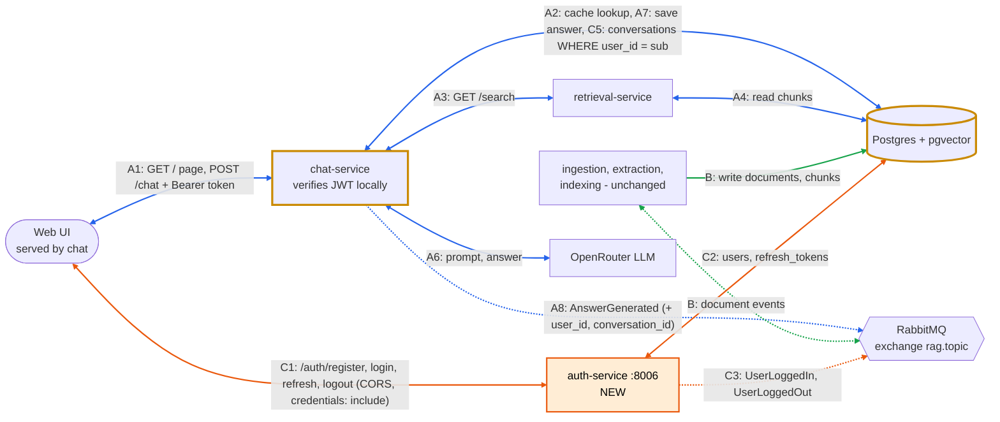

# Tier 1 design: User Authentication & Session Management

## A. What

**Feature:** user accounts, login and private per-user chat history.

**Why:** `/chat` does not identify users today, so conversations cannot be saved per person or protected. Every user-specific feature needs authentication first.

**User stories**

1. As a student, I want to register and log in so my chats are saved.
   - Valid email and password of 8+ characters gives 201. A duplicate email gives 409.
   - Correct credentials return an access token and set a refresh-token cookie. Wrong credentials give 401 with a generic message.
2. As a student, I want to log out so nobody else on a shared PC sees my chats.
   - Logout revokes the refresh token and clears the cookie. The revoked token can no longer get a new access token.
   - An access token already issued stays valid until it expires (at most 15 minutes).
3. As a student, I want my conversations to stay private so I can only see my own history.
   - `GET /conversations` returns only the logged-in user's conversations.
   - Another user's conversation ID returns 404, not 403.

## B. Where it fits

- **New:** auth service (port 8006). It issues and signs tokens and owns users and refresh tokens. It enables CORS for the chat origin.
- **Changed:** chat (8004) verifies the JWT itself, with no call to auth, and stores conversations per user. The DB gets four new tables (section C).
- **Unchanged:** ingestion, extraction, indexing, retrieval.



Orange = new (auth, flow C). Yellow border = changed (chat, DB). Blue (A) and green (B) are the flows from `docs/architecture/architecture-event-flow.md`, renumbered to include the Tier 2 cache steps (A2, A7; see `docs/features/design-tier2-rate-limit-cache.md`), with the pipeline services collapsed into one box. There is no chat → auth arrow, because chat verifies the JWT with auth's public key.

## C. Interfaces

**Auth endpoints**

| Method | Path | Body | Response |
|---|---|---|---|
| POST | /auth/register | {email, password} | 201 {user_id, email}; 409 |
| POST | /auth/login | {email, password} | 200 {access_token, token_type: "bearer", expires_in: 900} + refresh cookie; 401 |
| POST | /auth/refresh | refresh cookie | 200 new access_token, refresh token rotated; 401 |
| POST | /auth/logout | refresh cookie | 204, token revoked, cookie cleared |
| GET | /auth/me | Bearer | 200 {user_id, email}; 401 |

**Chat changes** (all need `Authorization: Bearer <token>` and return 401 without it): `POST /chat` takes `{question, conversation_id?}` and also returns `conversation_id`. New: `GET /conversations`, `GET /conversations/{id}/messages`, `DELETE /conversations/{id}`.

**JWT payload (draft):** `{"sub": "u123", "email": "a@lancaster.ac.uk", "iat": 1761900000, "exp": 1761900900, "jti": "t789"}`

**Events (draft).** New `UserLoggedIn` and `UserLoggedOut` use the standard envelope. Both carry only `user_id`, never tokens or passwords:

```json
{
  "eventType": "UserLoggedIn",
  "eventId": "3f2b8c1e-5d0a-4c1e-9a7b-1e2d3c4b5a70",
  "timestamp": "2026-11-01T10:00:00Z",
  "correlationId": "c1d2e3f4-1a2b-4c3d-8e9f-0a1b2c3d4e5f",
  "payload": { "user_id": "u123" }
}
```

Changed: `AnswerGenerated` adds `user_id` and `conversation_id` to its payload.

**Data model.** Each table has one owning service, which creates it on startup (`CREATE TABLE IF NOT EXISTS`) and is the only one that writes to it. IDs are UUIDs stored as `TEXT`.
- Auth: `users(id, email UNIQUE, password_hash, created_at)`, `refresh_tokens(id, user_id FK, token_hash, expires_at, revoked_at, created_at)`
- Chat: `conversations(id, user_id, title, created_at)`, `messages(id, conversation_id FK, role, content, citations JSONB, created_at)`

`conversations.user_id` holds the JWT `sub` as plain `TEXT`, with no FK to `users`, because that table belongs to another service. Deleting a user is out of scope.

## D. How

- **Passwords:** Argon2 or bcrypt hash. Never store or log plaintext.
- **Two tokens:** an access JWT (15 min), kept in UI memory and sent as `Authorization: Bearer`; and a random opaque refresh token (7 days) in an HttpOnly, `SameSite=Strict` cookie scoped to `/auth`. The DB stores only its hash, and it is rotated on every refresh.
- **Signing:** RS256 with PyJWT. Only auth holds the private key; chat gets the public key from config, so a compromised chat cannot mint tokens.
- **Verification in chat:** a FastAPI dependency checks signature and `exp`, pins `algorithms=["RS256"]` (rejects `alg: none`) and reads `user_id` from `sub`.
- **Isolation:** every query uses `WHERE user_id = :sub`. `user_id` is never taken from the request body.
- **Semantic cache:** shared between users, so it stores only question, answer and citations. On a hit, chat still saves the answer in the asking user's conversation, and `AnswerGenerated` carries that user's IDs.
- **Logout:** revokes the refresh token. The access token lives until expiry (at most 15 minutes), an accepted trade-off for an internal chatbot. A `jti` denylist is an optional fix.
- **CORS:** the UI is served by chat (8004) but calls auth (8006), a different origin, so auth enables CORS.
  - Auth allows only the chat origin from `CORS_ALLOWED_ORIGINS` (no `*`), with `allow_credentials=True` and the `Authorization` and `Content-Type` headers. FastAPI's `CORSMiddleware` answers the preflight `OPTIONS`.
  - The UI calls auth with `fetch(url, {credentials: "include"})`, otherwise the browser drops the refresh cookie. `SameSite` compares sites, not ports, so the cookie works across 8004 and 8006. Chat needs no CORS.
- **Open items** (settled in the Sprint 2 issue that touches each): RS256 key setup (mounted files or env vars, never committed); brute-force protection and email lowercasing (issue 3); whether refresh-token reuse revokes all of a user's tokens (issue 4); pinned library versions (`argon2-cffi`, `PyJWT[crypto]`, `email-validator`).

**Alternatives considered**

| Alternative | Pro | Con | Decision |
|---|---|---|---|
| Server-side sessions instead of JWT | Instant, true logout; simpler tokens | Every chat request needs a DB lookup or call to auth, so chat depends on auth at runtime and auth becomes a single point of failure | JWT: stateless, verified locally. Short expiry plus revocable refresh tokens covers most of the logout gap |
| Proxy `/auth/*` through chat instead of CORS | One origin, so no CORS and no `credentials` flag | Adds a chat → auth path (auth outage breaks logins), chat must forward `Set-Cookie`, and it contradicts the diagram | CORS on auth: keeps chat decoupled, a few lines of config |

## E. Plan (Sprint 2 issues)

| # | Issue | Est. | Owner |
|---|---|---|---|
| 1 | Scaffold auth service, docker-compose, .env.example, CORS config (`CORS_ALLOWED_ORIGINS`) | 0.5d | Amr |
| 2 | Create tables on startup (auth: users, refresh_tokens; chat: conversations, messages) | 1d | Walid |
| 3 | Register and login with hashing and JWT issuing | 1.5d | Layla |
| 4 | Refresh token rotation and logout revocation | 1.5d | Amr |
| 5 | Chat: JWT verification, scope `/chat` per user | 1d | Walid |
| 6 | Chat: conversation list, get and delete endpoints | 1d | Layla |
| 7 | Publish UserLoggedIn / UserLoggedOut | 0.5d | Amr |
| 8 | Web UI: login form, token handling (`credentials: "include"`), history view | 2d | Walid |
| 9 | Tests (section F), update contracts.md and architecture diagram | 1.5d | Layla |

## F. Verification

- **Unit:** password hashing; JWT encode/decode; expired, tampered, wrong-key and `alg: none` tokens rejected.
- **Integration** (pytest + TestClient + test Postgres): register → login → `/auth/me` 200; wrong password 401; reused old refresh token 401; refresh after logout 401.
- **Isolation and cache:** user A's conversation gives 404 to user B on GET and DELETE and is absent from B's list. If B asks A's cached question, B gets a cache hit saved in B's conversation, and `AnswerGenerated` carries B's IDs.
- **Security:** no plaintext passwords or refresh tokens in the DB, cookie flags set, no tokens in logs.
- **CORS:** the chat origin gets `Access-Control-Allow-Origin` and `Access-Control-Allow-Credentials: true`; an unlisted origin gets no CORS headers; preflight succeeds. Manual: login from the UI on 8004 sets the refresh cookie and `/auth/refresh` then works.
- **Done when** all acceptance criteria pass in CI.
